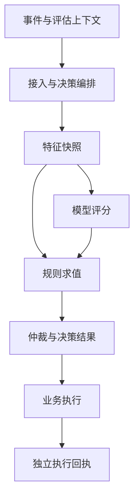

# 风控决策引擎系统设计 · 统一事件模型

> 上篇：[01-overall-architecture.md](./01-overall-architecture.md)（总体架构）。本文展开接入层的核心契约——统一事件模型。
>
> 设计目标：**任何业务方接入风控，只需要做一次字段映射，引擎侧不为新业务改代码。**

## 1. 设计原则

1. **分层：通用骨架 + 领域扩展**。不为所有业务设计一张大宽表——支付、登录、营销的字段差异太大，大宽表最终会变成几百个可空字段的垃圾场。正确做法是：一层所有事件共有的骨架（envelope），一层按事件类型定义的领域字段（payload），schema 分开管理。
2. **主体（Entity）是一等公民**。风控的本质是围绕"主体"累积风险画像：用户、设备、IP、卡、商户、收货地址……事件模型必须显式声明"这个事件涉及哪些主体、各扮演什么角色"，特征平台才能按主体维度做聚合。
3. **只传事实，不传结论**。事件里放"发生了什么"（金额、IP、时间），不放业务方自己的判断（"疑似风险用户=true"）。业务方的结论如果有价值，作为独立的信号字段单独建模，口径由风控侧定义。
4. **不可变 + 可版本化**。事件一旦上报不可修改；schema 变更走版本管理，向后兼容（只加可选字段，不改语义、不删字段）。

## 2. 结构设计

整体分四段：**envelope（信封）→ entities（主体）→ context（环境上下文）→ payload（领域数据）**。

```jsonc
{
  // ── 1. Envelope：所有事件必填的骨架 ──
  "event_id": "evt_7f3a...",            // 全局唯一，幂等去重用（业务方生成，格式约束）
  "event_type": "payment.card_charge",  // 分层命名：<域>.<动作>，注册制，不允许自由发挥
  "event_version": "1.2",               // 对应 payload schema 的版本
  "occurred_at": 1755590400123,         // 业务发生时间（毫秒 UTC）
  "received_at": 1755590400156,         // 风控收到时间（引擎侧填，用于测时钟偏移）
  "source": {
    "app_id": "checkout-service",       // 上报方身份（鉴权后填入，不信任请求体）
    "channel": "ios_app",               // 渠道：web / ios / android / api / pos
    "trace_id": "..."                   // 打通全链路排查
  },
  "mode": "sync",                       // sync=要决策结果 / async=仅记录（如事后补报）

  // ── 2. Entities：这个事件涉及的主体及其角色 ──
  "entities": [
    { "type": "user",     "id": "u_1001",         "role": "actor" },        // 操作发起者
    { "type": "device",   "id": "dfp_ab3f...",    "role": "actor_device" },
    { "type": "card",     "id": "card_tok_9x...", "role": "instrument" },   // 支付工具
    { "type": "merchant", "id": "m_2002",         "role": "counterparty" }
  ],

  // ── 3. Context：环境上下文（跨事件类型通用） ──
  "context": {
    "ip": "203.0.113.7",
    "user_agent": "...",
    "device_fingerprint_raw": { /* 指纹 SDK 原始采集，透传给指纹服务解析 */ },
    "geo": { "lat": 31.23, "lng": 121.47, "accuracy_m": 50 },
    "session_id": "sess_..."
  },

  // ── 4. Payload：按 event_type 定义的领域字段 ──
  "payload": {
    "amount": { "value": 128800, "currency": "CNY", "exponent": 2 },  // 最小货币单位整数，禁止浮点
    "order_id": "ord_...",
    "card_bin": "622202",
    "is_first_purchase": false
  }
}
```

### 2.1 Envelope

- `event_type` 用 `域.动作` 两级命名（`account.login`、`account.register`、`payment.card_charge`、`withdrawal.request`、`marketing.coupon_claim`），**注册制**：新事件类型必须在 schema registry 登记后才能上报，未注册类型直接拒收。这是防止事件模型腐化的第一道闸。
- `occurred_at` 和 `received_at` 分开存：客户端时钟不可信，聚合特征一律用 `received_at`，`occurred_at` 仅作参考；两者偏差本身就是一个不错的风险特征。
- `event_id` 由业务方生成并保证幂等——重试场景下同一 `event_id` 必须返回同一决策结果，而不是重新决策（否则限频类规则会把重试算成多次行为）。

### 2.2 Entities（设计重心）

用「**类型 + ID + 角色**」的数组，而不是固定字段（`user_id`、`merchant_id`……）。原因：

- 同一类型可以出现多次（转账事件有两个 user：`actor` 和 `counterparty`）；
- 新增主体类型（比如加"收货地址"实体）不需要改骨架；
- 特征平台可以按 `(entity_type, entity_id)` 统一做聚合——"该 IP 近1小时事件数"和"该卡近1小时事件数"是同一套计算框架。

约束与规范：

- 实体类型和角色都是受控枚举，注册管理。常用角色：`actor`（发起者）、`counterparty`（对手方）、`instrument`（支付工具）、`beneficiary`（受益方）、`actor_device`。
- 敏感标识（卡号、手机号、邮箱）**入模前先标准化 + tokenize/哈希**：引擎和特征存储只见 token，原文只留在有权限管控的映射服务里。这同时解决合规问题和"同一卡号不同格式算成两个主体"的问题。

### 2.3 Context

- 通用环境信息放这里而不是 payload，因为几乎所有事件都有、且特征口径统一（"IP 维度聚合"不应该关心事件类型）。
- 设备指纹分两个字段：SDK 原始采集包（透传给指纹服务）和解析后的 `device_fingerprint_id`（作为 entity）。接入层调指纹服务完成解析，业务方不参与。

### 2.4 Payload

- 每个 `event_type` 一份 JSON Schema，登记在 registry 里，接入层按 schema 强校验（类型、必填、枚举、金额格式），**校验失败在接入层就拒绝**，不让脏数据进引擎——否则脏数据会污染特征，排查成本极高。
- 金额一律「最小货币单位的整数 + 币种 + 精度」，禁止浮点；跨币种聚合特征由特征平台统一换汇，不在事件里做。
- 字段命名规范化（snake_case、布尔用 `is_/has_` 前缀、时间统一毫秒 UTC），registry 里每个字段带中文描述和负责人，这些元数据后续直接喂给规则编辑器做自动补全。

## 3. Schema Registry 与演进管理

Registry 管三类对象：

| 对象 | 内容 |
|---|---|
| 事件类型 | envelope 约束 + payload schema + 版本历史 |
| 实体类型 / 角色枚举 | 受控枚举及其语义定义 |
| 字段字典 | 跨事件复用的公共字段定义（如 `amount`、`ip`），避免每个 payload 重复定义且口径漂移 |

版本规则：

- 加可选字段 → 小版本，向后兼容，老接入方无感；
- 改类型/语义/删字段 → 大版本，新旧并行一段时间，引擎按 `event_version` 路由校验；
- **永远不复用字段名表达新语义**。线上可能有大量规则引用着老字段，语义悄悄变化会让这些规则无声地判错——不报错、只默默做错误决定，是风控最可怕的事故类型。

治理流程：每个事件类型有 owner（业务方）和 reviewer（风控方），schema 变更走 PR 式审批；上线后 registry 自动生成接入文档和各语言的 SDK/DTO。

## 4. 两个容易踩的坑

1. **不要让"决策请求"和"事件"变成两套模型**。同步决策请求就是一个 `mode=sync` 的事件；异步补报、批量导入历史数据用同一模型 `mode=async`。一套模型贯穿同步决策、实时特征计算、离线回测——这正是"实时/离线口径一致"的前提：回测时重放的就是当初的事件本身。
2. **实体关系不要塞进事件里**。"设备关联了多少账户"这类图关系是特征平台从事件流中**推导**出来的，事件只忠实记录"本次事件中这几个实体同时出现"。事件负责事实，图引擎负责关系。

## 5. 接入流程

一个新业务的接入流程最终收敛成：

```
在 registry 登记事件类型
  → 定义 payload schema
  → 映射实体和上下文字段
  → 联调校验
  → 影子上报观察数据质量
  → 转正
```

全程不需要引擎侧发版。

## 6. 消费信贷领域契约（新增）

本节是面向消费信贷的设计建议，沿用 envelope / entities / context / payload，不代表已确认的业务政策。授信阈值、定额定价、复用期限、贷中触发条件和处置权限均须业务评审后配置；本文不据此推断风险或收益改善。

### 6.1 事件事实、决策请求与执行结果

“客户提交了授信申请”是事实；“请评估该申请”是决策请求；“额度已生效”是执行事实。三者共享事件骨架，但不得混用语义或覆盖原事件。

原第4节“一套模型”的含义是共享契约，不是所有事件都必须决策。原 `mode=sync/async` 继续表示既有调用方式；为兼容异步贷中评估，在已注册的信贷 schema 中新增可选 `decision_context`。无该字段时维持旧行为；存在时，是否决策由该字段及服务端事件注册配置决定，`mode` 仅表示返回方式。禁止靠 payload 中的自由字段隐式触发决策。

| 对象 | 语义 | 是否产生决策 |
|---|---|---|
| 申请提交 / 评估请求事件 | 已提交申请或已生成评估任务，携带当前事实 | 按注册契约触发，同步或异步均可 |
| 还款、账单、逾期状态变化事件 | 业务系统已经确认的状态变化 | 默认只入库和更新特征；触发器可另建评估请求 |
| 决策完成事件 | 引擎记录某次评估的结论及版本 | 不再次触发同一决策，避免循环 |
| 额度生效、放款完成、处置完成事件 | 业务执行系统确认的结果 | 作为后续特征和监控输入，不等同于决策结论 |

引擎产出的结论属于独立、可追溯的结果事实，不回填为原始申请的“事实字段”。业务方传入的历史决策仅允许作为带来源、版本和时间的引用，不能直接冒充本次模型分或规则结论。

### 6.2 三类事件目录与主体

以下名称均为拟注册类型，沿用 `域.动作` 两级命名；字段是最小设计草案，必填性须在 registry 中落定。所有类型都带第2节公共骨架。

| 场景 / event_type | 核心 payload | 主要主体与角色 | 后续关联事实 |
|---|---|---|---|
| 授信 `credit.application_submitted` | application_id、product_id、申请金额 requested_limit（可选）、申请资料快照引用 applicant_snapshot_ref | user/borrower、application/subject；device/actor_device 按实际采集 | `credit.limit_activated`：credit_account_id、实际额度、effective_at、decision_id |
| 支用 `drawdown.application_submitted` | drawdown_id、credit_account_id、requested_amount、term_count、term_unit、repayment_method、账户状态快照引用 account_snapshot_ref | user/borrower、credit_account/subject、drawdown/application；card/disbursement_instrument 按实际采集 | `drawdown.disbursement_completed`：loan_id、实际放款金额、completed_at、decision_id |
| 贷中 `credit_monitoring.assessment_requested` | assessment_id、credit_account_id、trigger_type（scheduled/event/manual）、as_of、trigger_event_ids、账户状态快照引用 | user/borrower、credit_account/subject；loan/observed_loan 按评估粒度 | `credit_monitoring.action_completed`：action_id、action_type、执行前后状态、effective_at、decision_id |

状态输入可注册 `loan.repayment_posted`、`loan.delinquency_changed`、`loan.statement_generated`；须携带 loan_id、业务时间、源状态版本、快照/账务流水引用。完成事件仅用于成功事实；失败、取消、部分完成另行注册明确 schema，不伪装成成功。

application、credit_account、drawdown、loan 以及上述角色均须新增受控注册，不能假定已存在。客户、授信账户与借据不是同一粒度：一客户可有多个账户，一账户可有多笔支用。聚合必须声明粒度和角色，不能把每次借据评估重复累计成多个客户申请。payload 的业务 ID 与 entities 对应主体 ID 必须一致。无人操作的定时贷中事件允许 context 为空，不编造设备或 IP。

### 6.3 决策请求结构示例

下例为虚构授信请求；金额沿用最小货币单位。received_at 和 source.app_id 由接入层填充，调用方不能指定执行策略版本或回放权限。

```json
{
  "event_id": "evt_credit_demo_001",
  "event_type": "credit.application_submitted",
  "event_version": "1.0",
  "occurred_at": 1793059200000,
  "received_at": 1793059200010,
  "source": {
    "app_id": "credit-service",
    "channel": "api",
    "trace_id": "trace_demo_001"
  },
  "mode": "sync",
  "entities": [
    {"type": "user", "id": "u_demo", "role": "borrower"},
    {"type": "application", "id": "app_demo", "role": "subject"}
  ],
  "context": {},
  "payload": {
    "application_id": "app_demo",
    "product_id": "product_demo",
    "requested_limit": {"value": 2000000, "currency": "CNY", "exponent": 2},
    "applicant_snapshot_ref": "snapshot_demo"
  },
  "decision_context": {
    "request_id": "req_demo_001",
    "decision_scene": "credit_grant",
    "deadline_at": 1793059205000
  }
}
```

新增字段约束：

- `request_id`：一次逻辑评估的稳定标识；网络重试不换号。一次新申请或授权重新评估使用新 request_id 和 event_id，显式关联前次评估。
- `decision_scene`：受控枚举 credit_grant / drawdown / credit_management；与 event_type、product_id、调用方权限组合校验，服务端固定本次策略包版本。
- `deadline_at`：调用截止时间，由服务端预算上限约束；超时不能伪装成业务拒绝或通过。
- `correlation_id`（可选 envelope 扩展）：关联申请全生命周期；`causation_id`（可选）：直接触发本事件的 event_id。完成事件另带 decision_id 和 action_id。
- 快照引用必须指向不可变、授权可读且在保存期内可解析的内容；保存来源、采集时间和内容摘要，不能引用会被覆盖的“最新客户资料”。

幂等作用域至少包括 app_id、decision_scene、request_id；event_id 继续承担事件去重。相同标识但内容摘要不同应报冲突；并发重试共享处理中状态或既有结果，不重复计算特征与执行动作。幂等记录保存期须覆盖业务重试窗口，具体时长待定。

### 6.4 决策输出与业务执行

统一结果包含 decision_id、request_id、event_id、decision_scene、decided_at、technical_status、outcome、reason_codes、策略/模型/特征版本引用及 snapshot_id。

`technical_status` 区分 SUCCEEDED / PENDING / FAILED / TIMEOUT；只有成功完成评估时才填业务 outcome（沿用 PASS / DENY / REVIEW / CHALLENGE）。PENDING、超时和必需输入缺失不能解释为 PASS。REVIEW/CHALLENGE 表示转交下一步，本次结果保留；人工或补件完成后另建关联评估。

| 场景 | 成功结果的领域输出（按实际策略选填） | 执行边界 |
|---|---|---|
| 授信 | proposed_limit、pricing_terms、valid_until、附加条件 | 授信账户系统审批衔接并落地额度与合同条件，返回额度生效事实 |
| 支用 | approved_amount、approved_term、pricing_terms、valid_until | 支用系统复核账户状态、可用额度和结果有效期，原子占用额度后执行放款 |
| 贷中 | proposed_actions[]：action_id、action_type、target、参数、expected_state_version、有效期 | 账户/贷后系统校验权限与当前状态，执行后逐项回报成功或失败 |

额度、期限、定价的单位和计息口径必须在 schema 中声明；没有计算该项就不输出，缺失不等于零。DENY 不携带可执行放款指令。PASS 不证明合同已签、额度已变更或放款成功。贷中动作如调额、暂停支用、转人工仅为可注册能力示例，是否允许自动执行待业务确认。

贷中分为“监控 → 触发 → 处置”：监控产出事实和特征，触发器建立去重的评估任务，决策输出处置建议，执行系统负责状态变更。多个动作的互斥、优先级、人工审批和部分失败补偿须配置并留痕，不能简单套用 DENY > REVIEW > PASS 来仲裁不同维度动作。

### 6.5 时点、计数与回放

保留现有 received_at 作为线上行为计数默认时间轴。对可信账务系统的还款、逾期和账单事件，特征注册可显式选择业务时间，但必须同时记录首次可用时间 available_at、源版本及迟到处理规则。历史决策只能读取当时已可用的事实；今天补报的历史还款不能进入昨天的原决策快照。

- 申请次数、决策次数、放款次数分别基于对应事件去重统计。一次申请的重试、补报和决策完成不能重复算申请或放款。
- 每个特征声明是否包含当前事件；建议历史窗口默认排除当前 event_id，本次申请属性直接读 payload。若包含当前事件，须保证恰好计入一次，不能依赖 Kafka/Flink 消费先后来碰运气。
- 原决策复现读取固化的输入、特征值/状态、模型输出及全部执行版本；原始事件本身不足以完整回放，不能实时重查外数替代历史值。
- 新策略回测创建独立 run_id，使用 point-in-time 数据并标记为模拟。复现与回测均禁止写生产特征计数、发起外部征信查询、变更额度或放款。缺失历史版本/快照时明确标为不可完整复现。

## 7. 消费信贷模块输入输出与边界（新增）

| 模块 | 输入 | 输出 | 职责边界 |
|---|---|---|---|
| 业务系统 / 接入层 | 申请或账户事实、鉴权身份、事件 schema | 校验后的标准事件、幂等受理状态 | 校验不等于风控通过；业务系统提供事实，接入层不生成评分结论 |
| 决策编排 | 标准事件、场景路由、已发布策略包 | 依赖执行图、固定版本、超时预算、各模块调用 | 按依赖分阶段执行，规则不能自行 IO |
| 名单服务 | 主体 token、名单及版本 | 命中项、来源、有效期 | 名单命中是输入证据，是否豁免/拦截由已审批策略决定 |
| 特征平台 | 主体与角色、feature_ids、请求时点、原始事实 | FeatureSet：值、类型、状态、as_of、available_at、口径版本、来源 | 不决定是否授信；MISSING/TIMEOUT/STALE 与真实零值分开 |
| 模型服务 | 固定模型版本、匹配的 FeatureSet、预处理版本 | ModelResult：score、分值含义/方向、状态、模型版本 | 分值不天然等于概率，不直接变更额度；缺失/超时不得填成低风险分 |
| 规则引擎 | 事件、FeatureSet、显式 ModelResult、规则集版本 | RuleResult：命中项、候选动作/参数、原因、执行/跳过状态 | 只纯内存求值，不取数、不调用模型、不写业务状态 |
| 决策仲裁 | 候选动作、定额定价等策略结果、冲突配置 | 最终 DecisionResult 与领域输出 | 按场景仲裁；额度、定价和贷中动作不能一律按动作严重度合并 |
| 业务执行 / 案件中心 | 有效 DecisionResult、当前账户版本、权限 | 业务执行事实 / 人审结论 | 幂等、并发校验、额度占用和放款由执行系统保证 |
| 审计与回放 | 事件及各阶段输入输出、版本、最终执行事实 | 不可变快照、模拟结果、可追溯链路 | 回放隔离生产副作用；标签按成熟期关联，不混入历史输入 |

执行关系：事件进入编排，按策略包依赖批量取特征；模型使用声明的特征打分；依赖评分的规则在模型返回后求值；仲裁生成决策；业务执行并回流事实。不依赖模型的前置规则可先执行；需要条件调用外数时，由编排显式进入下一阶段，每阶段先收齐依赖再求值。由此保留规则与模型解耦，同时避免“规则先跑完再取模型分”的依赖矛盾。

FeatureSet 与 ModelResult 分开留痕；规则可通过受控别名引用模型分，但原始事件中不放入本次计算结果。策略包须固定规则、模型、预处理、特征口径、路由、仲裁与降级配置。必要特征或模型失败走已审批的场景兜底，不能把通用支付示例的默认放行动作直接移植到授信、支用。

## 8. 章节调整与待确认项（新增）

| 文件 / 章节 | 本次调整 |
|---|---|
| 01 总体架构 · 新增第6节 | 链接信贷契约，说明原模块列表不是固定执行顺序，明确业务执行边界 |
| 02 统一事件模型 · 新增第6节 | 信贷事件目录、请求/输出、幂等、时点及回放约束；对原2.1和第4节的 mode 语义作兼容扩展 |
| 02 统一事件模型 · 新增第7节 | 模块输入输出、执行依赖与职责边界 |
| 02 统一事件模型 · 新增第8节 | 变更定位及待确认清单 |
| 03 特征平台 · 新增第10节 | 信贷时点、缺失值、申请/放款计数和条件取数接口约束 |
| 04 规则引擎 · 新增第8节 | 模型依赖、分阶段编排和候选动作契约 |

原支付/登录示例保留作为通用能力说明；在消费信贷范围内，以上新增约束对原文的简化表述作限定。本次仅补设计文档，未提供可执行 JSON Schema 或实现保证。

待确认：各事件 owner 与 schema 必填字段；客户/账户/借据主体映射；授信与支用策略是否复用及其条件；额度/定价算法和审批权限；贷中触发、互斥处置和补偿；外数授权及缓存期限；各场景 SLA、兜底动作、幂等与快照保存期。上述事项均无足够现有材料确认，本次不填入阈值或业务效果结论。

## 9. 契约验收与审计可靠性（新增）

本节沿用第6—8节的 decision_context、FeatureSet、ModelResult 与事件命名，不另建第二套接口。

### 9.1 依赖与执行闭环



图表示依赖关系，不强制每次评估调用全部模块。回执进入事件流后，只有经注册触发条件才可建立新评估，禁止回执自动循环决策。

- 权威账户快照需校验客户归属、数据新鲜度及源状态版本；业务方携带的余额不能未经校验作为可用额度。放款时再次校验并原子占用额度。
- 决策受理时由服务端锁定评估基准时间与版本；deadline_at 是超时预算，不是历史取数时点，payload.as_of 不能授予调用方任意回看或读取未来数据的能力。
- 更正/冲正使用新 event_id、原事件或账务流水引用、原因及源版本。事实不覆盖修改；乱序变更按对象版本处理，不按到达顺序覆盖状态。更正不自动撤销已执行的业务动作。
- technical_status 与 outcome 分离；特征默认值、模型降级另留状态及原因。业务执行回执逐动作记录 action_id、decision_id、目标版本、实际执行时点及失败码。
- 决策完成记录、幂等结果和审计投递需要可靠关联，可采用持久化日志/事务发件箱；异步写 OLAP 必须有重试、去重和对账，尽力投递不能视为完整审计。
- 模型原样复现需保存制品及预处理版本，固定可复现设置或使用当时已记录输出；仅重跑当前模型不能称作复现。证据引用丢失时标记不可完整复现。
- 内部 reason_codes 保持稳定，对客展示另作受控映射；原始特征、模型分与反欺诈细节不直接作为对客文案。

### 9.2 最小验收用例

| 情形 | 预期契约 |
|---|---|
| 同评估请求重复或并发提交 | 返回处理中状态或既有结果；事实计数、额度占用及执行动作不重复 |
| 同幂等标识改变金额或账户 | 内容摘要冲突，不能静默返回旧结果 |
| 同一申请真实重提 | 新事件与请求，保留关联；不把网络重试当成新申请 |
| 授信通过后申请支用 | 路由 drawdown，关联授信依据；不自动继承授信批准 |
| 支用 PASS，实际放款失败 | 保留原评估与失败回执；成功放款数不增加 |
| 贷中批量评估没有设备/IP | 按注册 schema 接受，缺失设备不自动等于高风险 |
| 必要特征缺失、模型超时 | 显式异常/降级状态，走已发布场景兜底；不填正常零值 |
| 非法 payload 或未授权调用 | 协议/权限错误；不记成客户信用拒绝 |
| 历史还款补报、冲正或状态乱序 | 保留业务时间、首次可见时间与版本，历史评估不读事后信息 |
| 贷中互斥动作或部分执行失败 | 仲裁/执行明确逐项状态和补偿，不声称全部已执行 |
| 历史回放与影子评估 | 无生产计数、收费外数调用、额度变更及放款副作用 |

以上为设计验收要求，尚未提供实现或执行自动化测试。

### 9.3 本次续补章节定位

| 文件/章节 | 新增或调整 |
|---|---|
| 02 新增 §9 | 依赖图、权威快照校验、更正/冲正、可靠审计与最小验收用例 |
| 03 §10 追加 | 按第9节补充时间与数据质量验收要求 |
| 04 §8 追加 | 明确名单函数无 IO 和影子规则独立执行约束 |

第8节既有待确认清单继续有效。本节不设定额度、定价、阈值、策略复用期限或贷中处置政策。
